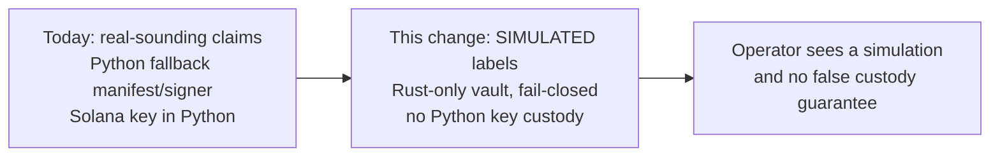

## Review Card (≤ 5 min)

| Field | Value |
|---|---|
| Outcome | The vault is named `SimulatedVault`, every manifest, receipt, and UI surface is labelled `SIMULATED`, Python holds no key and fabricates no manifest or signature, and live mode refuses to start without a secret-mounted seed. |
| Why now | Issue #2 shows the vault claiming BIP-32/BIP-44/SLIP-0010 derivation, spendable addresses, and whitelist enforcement that it does not implement. An operator could send real funds to an address with no chain meaning. |
| Blast radius | `engine-rs` (`common`, `risk-gate`, `node`), backend (`hierarchy.py`, `state_store.py`, `solana_tools.py`, `server.py`), the leaf UI, vault docs, ADR-0003, README, AGENTS.md, and tests. No `PolicyEnvelope`, Redis schema, or strategy-pod change. |
| Risk | Medium. Worst failure: a legitimate paper or devnet run is refused because the Rust binary or seed is unavailable. Every refusal is explicit and fail-closed. |
| Effort | L (SPEC + PLAN + DEV). |
| Decision needed | Approve the **BREAKING** manifest/receipt contract rename and the removal of Python-held Solana signing. |

## Why

- Issue #2 observed that the documented cryptographic guarantees are not implemented, while the manifest and UI present them as facts.
- The most dangerous failure mode is trust: an operator may route capital to a derived address that no chain can spend, or rely on a whitelist that only matches prefixes.
- Python can currently fabricate both the manifest and a signature, and it still loads `SOLANA_PRIVATE_KEY` and broadcasts a live self-transfer.
- This change removes the false guarantees and the Python key custody. It does not attempt the real cryptography; issue #2 stays open for that work.

## What Changes

- Rename the Rust vault type to `SimulatedVault`; the manifest reports `vault_mode: SIMULATED`, and wallet descriptors and receipts carry explicit simulation and non-spendability flags.
- Add an explicit live-mode gate: `LIVE` without a non-empty secret-mounted seed fails closed; the deterministic devnet seed is permitted only outside live mode and is reported as a seed source, never as the vault mode.
- Remove the Python fallback manifest and the Python HMAC signer; when the Rust binary is unavailable, vault endpoints and checkout fail closed with no fabricated data and no state mutation.
- Remove Python private-key custody: no `SOLANA_PRIVATE_KEY` read, no signing `Keypair`, no `transfer_sol(..., simulate_only=False)`, no broadcast. The Solana path is explicitly simulated and labelled.
- Derive `destination_whitelisted` and `key_zeroized_after_sign` from the actual check, or remove them; label whitelist enforcement as simulated.
- Update documentation, README, AGENTS.md, ADR-0003, UI wording, and tests so every surface states `SIMULATED`.
- **BREAKING (manifest/receipt contract)**: `vault_mode` becomes `SIMULATED`; new simulation/non-spendability flags are required; the unqualified `withdrawal_whitelist_enforced: true` is replaced by a simulated label.

## Capabilities

### New Capabilities

- `vault-simulation`: the honest-simulation contract for the Rust vault, the Python boundaries, live-mode seed handling, derived safety flags, and the documentation/UI/test guarantees.

### Modified Capabilities

- None. The existing `contract` spec covers `PolicyEnvelope` only; no existing requirement governs vault claims.

## Non-goals

- Implementing real BIP-32, BIP-44, SLIP-0010, CIP-1852, secp256k1, ed25519, or sr25519 derivation.
- Producing real address encodings (base58check, bech32, SS58, principal IDs) or real chain signatures (ECDSA, Schnorr, Ed25519, sr25519).
- Real mainnet key custody, hardware security modules, or remote signers.
- Replacing prefix matching with exact per-chain allowlists, a network allowlist, or per-chain amount caps.
- Moving Solana signing into Rust; the Python signing path is removed, not relocated.
- Changing `PolicyEnvelope`, the dry-powder floor, Kelly sizing, the kill-switch semantics, or any strategy pod.
- Closing issue #2. This change covers the honest-simulation slice only.

## Impact

- **Rust**: `engine-rs/crates/common/src/lib.rs` (manifest and receipt contract), `engine-rs/crates/risk-gate/src/vault.rs` (`SimulatedVault`, seed and mode handling, derived flags), `engine-rs/crates/risk-gate/src/lib.rs` (tests), `engine-rs/crates/node/src/main.rs` (CLI exit behavior).
- **Backend**: `backend/core/hierarchy.py` (remove fallback manifest/signer, fail closed), `backend/core/state_store.py` (simulated Solana tick, no broadcast), `backend/tools/solana_tools.py` (no key custody), `backend/server.py` (manifest 503 and testnet verify), backend tests.
- **Frontend**: `frontend/src/components/LeafAgentView.jsx` renders a visible `SIMULATED` vault badge and no real-custody claim.
- **Docs**: `docs/CRYPTO_VAULT_AND_KEY_MANAGEMENT.md`, `README.md`, `AGENTS.md`, `docs/adr/0003-hierarchical-multi-ecosystem-architecture.md`, `.env.example`.
- **API contract**: `GET /api/v1/vault/manifest` returns HTTP 503 when the Rust vault is unavailable and, when available, a manifest with `vault_mode: SIMULATED` and simulation flags. `POST /api/v1/treasury/checkout` returns a fail-closed rejection when the vault is unavailable. Both are **BREAKING** for consumers that expect the old fields.
- **Backtest / paper / live**: backtest and paper are unaffected in behavior and remain deterministic. Live mode now refuses to construct the vault without a secret-mounted seed; no live broadcast is introduced or retained.
- **Security posture**: no key material is added anywhere; Python private-key access and the fabricated-signature path are removed.
