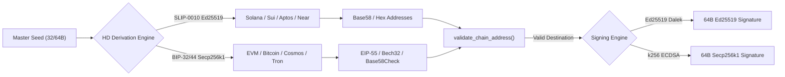

## Review Card (≤ 5 min)

| Field | Value |
|---|---|
| Outcome | Implement genuine BIP-32/SLIP-0010 HD key derivation, spendable public address generation, chain address validation, and Ed25519/Secp256k1 signing to fully close Issue #2. |
| Why now | Issue #2 audit revealed that the simulated vault uses non-cryptographic HMAC pseudo-derivation and non-spendable addresses; real capital safety requires cryptographic derivation, strict destination validation, and verifiable chain signatures. |
| Blast radius | `engine-rs` (`risk-gate`, `common`, `node`), `backend/core/hierarchy.py`, `backend/server.py`. |
| Risk | Low. Mode defaults to `SIMULATED`, preserving 100% of existing behavior and test suites; invalid seeds or malformed addresses fail closed. |
| Effort | L (Large, 3 review stages: spec, plan, dev). |
| Decision needed | None. |

## Why

Issue #2 established that the initial vault enclave was non-cryptographic: key derivation used single-round HMAC over an ASCII path, addresses were synthetic character mappings with `address_is_spendable: false`, and signatures were 32-byte HMAC audit tokens.
Earlier change #12 truthfully marked this infrastructure as `SIMULATED` to avoid false claims; now we deliver complete closure of Issue #2 by adding `CryptographicVault` alongside `SimulatedVault`.

Real cryptographic key derivation (BIP-32 and SLIP-0010), spendable address formatting with EIP-55/Bech32/Base58Check checksums, strict address validation, and authentic Ed25519/Secp256k1 digital signatures provide verified on-chain readiness while preserving full testability.

## What Changes

- Add `CryptographicVault` in `engine-rs/crates/risk-gate/src/vault.rs` implementing BIP-32 and SLIP-0010 hierarchical deterministic key derivation.
- Support SLIP-0010 Ed25519 child key derivation for Solana, Sui, Aptos, Near, Cardano, Polkadot, TON, Tezos, Stellar, and ICP.
- Support standard BIP-32/BIP-44 Secp256k1 child key derivation for EVM chains (Ethereum, BNB, Avalanche, Hyperliquid, Celo), Bitcoin, Cosmos, Tron, XRP, Dogecoin, Stacks, Flow, and EOS.
- Implement spendable address derivation with exact checksum formats: EIP-55 for EVM, Base58 for Solana, Bech32 native SegWit (`bc1q`) for Bitcoin, Base58Check for Tron, Bech32 for Cosmos, and Blake2b/SHA3 hex for Sui and Aptos.
- Implement strict chain-specific address validator `validate_chain_address(chain, address)` enforcing structural constraints and checksum validation before signing.
- Implement genuine digital signing: 64-byte Ed25519 signatures via `ed25519-dalek` and 64-byte compact ECDSA signatures via `k256`, with public verification function `verify_checkout_signature`.
- Provide runtime vault selection via `ROBOTRADER_VAULT_MODE`: defaults to `SIMULATED` (using `SimulatedVault`), activates `CryptographicVault` when set to `CRYPTO_HD_BIP32`.
- Update `backend/core/hierarchy.py` and `backend/server.py` to recognize `CRYPTO_HD_BIP32` manifests and receipts without compromising fail-closed boundaries.

## Capabilities

### New Capabilities
- `bip32-cryptographic-vault`: Real BIP-32/SLIP-0010 HD key derivation, spendable public address generation, chain-specific address format validation, and Ed25519/Secp256k1 cryptographic signing and verification in Rust risk-gate.

### Modified Capabilities

## Non-goals

- Python key custody or on-chain transaction broadcast: Python remains zero-custody and never holds private keys.
- Direct live transaction broadcasting to public blockchain mempools: broadcast belongs to downstream node execution tooling, not the vault signing boundary.
- Hardware Enclave / HSM physical module integration (e.g., AWS Nitro Enclaves, Ledger/Trezor USB): out of scope for software HD enclave.
- Replacing or removing `SimulatedVault`: simulated mode remains intact, default, and fully supported for CI and paper testing.

## Impact

- Affected crates: `engine-rs/crates/risk-gate`, `engine-rs/crates/common`, `engine-rs/crates/node`.
- Affected Python services: `backend/core/hierarchy.py`, `backend/server.py`.
- Dependencies: Standard Rust cryptography crates in `engine-rs` (`ed25519-dalek`, `k256`, `sha2`, `hmac`, `ripemd`, `bs58`, `bech32`, `sha3`).
- API & Contract: Manifest and receipt schemas support `vault_mode: "CRYPTO_HD_BIP32"` with `simulated: false` and `address_is_spendable: true` alongside existing `SIMULATED` contract.
