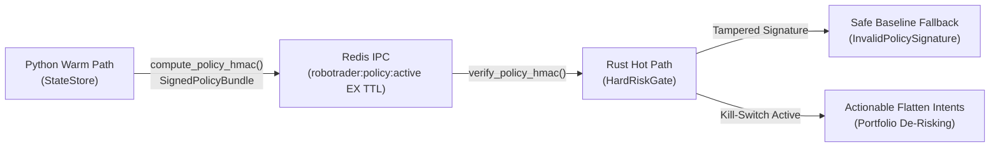

# Proposal: sign-policy-and-flatten-killswitch

## Review Card (≤ 5 min)

| Field | Value |
|---|---|
| Outcome | Cryptographically authenticates policy envelopes via cross-language HMAC-SHA256, enforces 15-minute Redis key TTL, and generates actionable market-flatten intents on kill-switch activation. |
| Why now | Completes the remaining security gaps in Issue #8 where policy envelopes are unsigned in Redis, keys never expire in the cache, and emergency kill-switches lack automated position de-risking. |
| Blast radius | `backend/core/schemas.py`, `backend/core/state_store.py`, `engine-rs/crates/common`, `engine-rs/crates/risk-gate`, Redis `robotrader:policy:active` key. |
| Risk | Medium. Tampered envelopes fail closed to safe baseline, while kill-switch emergency flattens generate deterministic reduce-only market orders. |
| Effort | L (Lane L, cross-language contract synchronization between Python and Rust). |
| Decision needed | None. Follows canonical Issue #8 architecture requirements and preserves existing six-key `PolicyEnvelope` wire shape. |

## Why

Issue #8 demonstrated that `PolicyEnvelope` instances lacked cryptographic authenticity, leaving the control plane vulnerable to unauthorized or tampered policy injection via exposed Redis instances. Furthermore, the documented `robotrader:policy:active` key with explicit Redis `EX` expiration was never published, and kill-switch activation in Python was non-actionable as it neither propagated to Rust trade evaluation nor generated emergency position flattening orders.

This change closes the final slice of Issue #8 by establishing detached canonical HMAC-SHA256 signing across Python and Rust, publishing active policy envelopes to Redis with native key expiration, and providing deterministic portfolio flattening upon kill-switch activation.

## What Changes

- **Detached Canonical HMAC-SHA256 Policy Signing**: Introduces cross-language canonical serialization and HMAC-SHA256 signing (`compute_policy_hmac`, `verify_policy_hmac`) in Python and Rust over the unmodified 6-key `PolicyEnvelope`, packaging signatures into detached `SignedPolicyBundle` payloads.
- **Fail-Closed State Store Policy Verification**: Configures `StateStore` to sign newly issued policies with `ROBOTRADER_POLICY_HMAC_KEY` (with local development fallback) and automatically fall back to `PolicyEnvelope.safe_baseline()` whenever stored policy signatures are missing or fail verification.
- **Hot-Path Signed Envelope Gate**: Extends `HardRiskGate` with `validate_signed_envelope` to reject tampered or unverified policy signatures with `RiskRejection::InvalidPolicySignature` prior to pod allocation evaluation, while retaining backward compatibility for unsigned fixture replay.
- **Redis Active Policy Publication with EX Expiration**: Implements `set_with_ex` in the minimal Redis client and publishes `SignedPolicyBundle` to `robotrader:policy:active` with `EX <ttl_seconds>` on every policy persistence tick, alongside the legacy snapshot.
- **Actionable Kill-Switch Cancel and Flatten Contract**: Adds `trigger_kill_switch_with_flatten` and flatten intent generation in `HardRiskGate` to emit deterministic `reduce_only` opposite-side market orders across non-zero portfolio exposures, recorded by `StateStore.set_kill_switch` in the status payload.

## Capabilities

### New Capabilities
None.

### Modified Capabilities
- `control-plane-security`: Extends control plane security to mandate detached canonical HMAC-SHA256 policy signing and verification, Redis active policy key TTL publication, and actionable kill-switch cancel and flatten intents.

## Non-goals

- Modifying the six existing top-level fields of `PolicyEnvelope` (the wire shape remains strictly six keys per `policy-ttl` specification).
- Replacing the primary state snapshot key `robotrader:v2:state` (the active policy key is published in addition to the state snapshot).
- Implementing live external exchange order cancellation protocols in this slice (focus is deterministic risk-gate and state store intent emission).
- Asymmetric public-key cryptography or external key vaults (pre-shared secret HMAC-SHA256 is used per architectural contract).

## Impact

- `backend/core/schemas.py`: Canonical JSON serialization, `compute_policy_hmac`, `verify_policy_hmac`, and `SignedPolicyBundle` definition.
- `backend/core/state_store.py`: Minimal Redis `SET ... EX` command support, policy signing on issue, signature verification on restore with safe baseline fallback, and flatten intent recording on kill switch.
- `engine-rs/crates/common/src/lib.rs`: Rust canonical JSON serialization and HMAC-SHA256 computation/verification matching Python digests, and `reduce_only` field on `OrderIntent`.
- `engine-rs/crates/risk-gate/src/lib.rs`: `validate_signed_envelope`, `RiskRejection::InvalidPolicySignature`, and `trigger_kill_switch_with_flatten` intent generation.
- `backend/tests/`: Integration tests asserting cross-language HMAC digest parity and tamper rejection.
