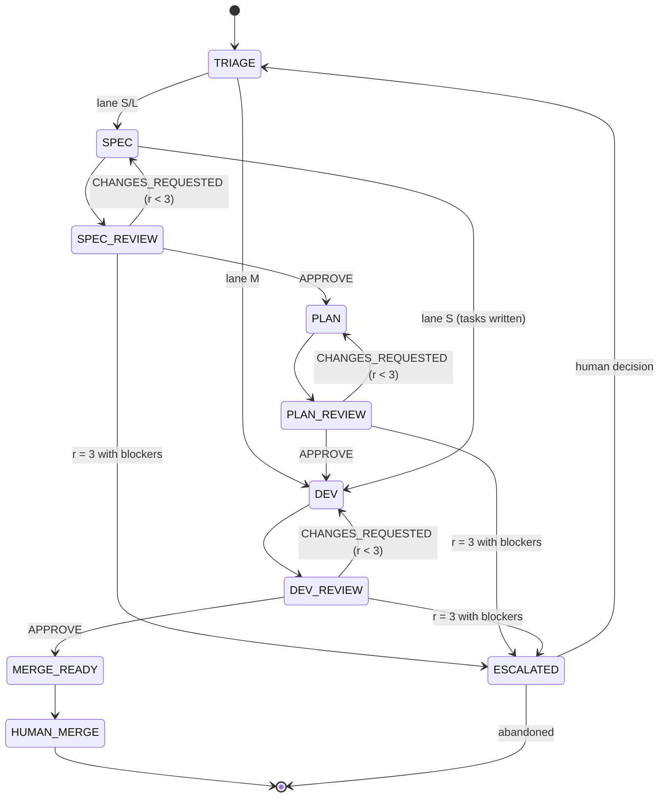

# Robotrader SDLC Protocol (normative)

> This file is the single source of truth for the delivery workflow.
> Human-oriented explanation and diagrams: `docs/sdlc/README.md`.
> If a doc, prompt, or habit disagrees with this file, this file wins.

**Version**: 1.0 · **Status**: active · **Applies to**: every change in this repository.

---

## 1. Principles

1. **Right-sized, not ceremony.** A typo does not need a specification. A risk-gate change does.
2. **Separate minds.** The author of an artifact never reviews it. The orchestrator never authors or reviews.
3. **Cold review.** Each review round is a fresh agent instance with no shared conversation. Independence is structural, not a promise.
4. **Artifact memory, not chat memory.** Reviewers resume from a persisted ledger, never from another agent's reasoning trace.
5. **Bounded loops.** Three review rounds per stage, hard stop. Escalate instead of iterating forever.
6. **Evidence over opinion.** Every finding cites a location and a proof. Every approval cites the reviewed SHA.
7. **The human reads five minutes, not fifty.** Specs carry a Review Card sized for a five-minute decision; delta specs are the machine contract.
8. **No agent merges.** The final merge is a human decision.

---

## 2. Lanes

The conductor picks a lane before any artifact is written and records the reason in `state.json`.

| Lane | Name | SPEC | PLAN | DEV | Cold reviewers |
|---|---|---|---|---|---|
| **M** | Micro | — | — | yes | dev |
| **S** | Standard | proposal + specs + tasks | — | yes | spec, dev |
| **L** | Large | proposal + specs | design + tasks | yes | spec, plan, dev |

### 2.1 Lane rubric

**Lane M — all of these must hold**

- ≤ 2 files, one module/crate/service.
- No public contract change (`PolicyEnvelope`, Redis IPC, REST/WS, CLI, DB schema).
- No money, risk, vault, key, or execution-routing path.
- No new dependency, migration, or ADR.
- Behavior change is a fix; docs/tests/typos/dependency bumps included.
- Existing tests already cover the change.

**Lane S — any of these**

- New user-visible behavior, or a non-trivial refactor.
- 3–10 files, one service or crate.
- Additive contract change.
- New config, UI, or observability.
- Needs a task list, but no architectural decision document.

**Lane L — any of these**

- Breaking contract or schema change, or cross-service contract synchronization.
- Money, risk, vault, key, or execution-routing path.
- > 10 files, or crosses Rust + Python + frontend boundaries.
- New architectural pattern, security-sensitive dependency, or data migration.
- Hard to reverse, or requires an ADR.

**Tie-break**: choose the higher lane. **When uncertain**: choose the higher lane.

**Lane changes**:
- Upgrade (M→S, S→L) is autonomous; record `lane_change` in `state.json` and the issue.
- Downgrade (L→S, S→M) removes safeguards and requires human approval (escalation `lane-downgrade`).

---

## 3. Artifacts

```
openspec/changes/<change-id>/        # SPEC/PLAN artifacts (lanes S/L)
├── .openspec.yaml                  # OpenSpec scaffold metadata
├── proposal.md                     # SPEC: Review Card + Why + What + Capabilities + Non-goals + Impact
├── specs/<capability>/spec.md      # SPEC: ADDED/MODIFIED/REMOVED/RENAMED requirements + scenarios
├── design.md                       # PLAN (Lane L only): decisions, risks, rollback
└── tasks.md                        # SPEC for S / PLAN for L: checkbox tasks + Verification

.sdlc/<change-id>/                  # runtime ledger (every lane)
├── state.json                      # machine state (lane, rounds, gates, SHAs)
├── revisions/<stage>-r<N>-response.md
├── reviews/<stage>-r<N>.md         # cold verdict + machine JSON block
├── evidence/<...>                  # test logs, benchmark output, screenshots
├── briefs/<stage>-r<N>-<role>.md   # exact brief given to the cold agent
└── merge-dossier.md                # generated at merge-ready, <= 5 min read
```

`sdlc/` (no dot) holds the definitions: protocol, agents, checklists, schemas,
templates. `.sdlc/` (dot) holds the per-change runtime ledger. Do not confuse
them.

Rules:

- `<change-id>` is kebab-case and stable for the life of the change.
- The issue logbook is the canonical **status** surface. `state.json` is the machine **cache**. Artifacts in git are canonical for content.
- Commit `.sdlc/<change-id>/state.json`, `reviews/`, `revisions/`, and `briefs/`
  with the change. `evidence/` is gitignored; attach its output in the issue or PR.
- Never edit a prior review verdict. Append a new round.
- Never put secrets, keys, or production data in `evidence/`.

---

## 4. Roles and boundaries

| Role | May write | May review | Must never |
|---|---|---|---|
| `sdlc-conductor` | issue, state, worktree, dispatch, dossier request | — | author artifacts, review, merge |
| `sdlc-spec-author` | `proposal.md`, `specs/**`, `tasks.md` (Lane S) | — | touch code, `design.md`, or review |
| `sdlc-spec-reviewer` | `reviews/spec-r<N>.md` only | SPEC | edit the spec, read author chat |
| `sdlc-plan-author` | `design.md`, `tasks.md` (Lane L) | — | change `specs/**` or code |
| `sdlc-plan-reviewer` | `reviews/plan-r<N>.md` only | PLAN | edit the plan, read author chat |
| `sdlc-dev` | code, tests, `tasks.md` checkboxes, `revisions/*` | — | change spec/design, self-approve |
| `sdlc-dev-reviewer` | `reviews/dev-r<N>.md` only | DEV diff | edit code, trust author logs |
| `sdlc-merge-verifier` | `merge-dossier.md` only | all gates | merge, approve findings on behalf of a reviewer |
| Human operator | decision, merge | final review | — |

**Independence checks** (the conductor enforces):

- Reviewer name ≠ author name for the same stage.
- Reviewer instance is fresh (new session or new subagent invocation).
- Reviewer did not write any file outside `reviews/`.
- Dev reviewer reviewed the exact SHA recorded in `reviewed_sha`.

---

## 5. State machine



Stage names are exactly: `spec`, `plan`, `dev`. `triage` and `merge` are conductor stages.

### 5.1 Stage entry conditions

| Stage | Enters when | Exit when |
|---|---|---|
| `spec` | lane S/L, issue + worktree exist | spec verdict `APPROVE` |
| `plan` | lane L, approved spec | plan verdict `APPROVE` |
| `dev` | approved spec (S) or approved plan (L), PR open as draft | dev verdict `APPROVE` |
| `merge` | all required verdicts `APPROVE`, CI green, no open blocker/major | human merge |

### 5.2 Stage ownership

- A stage author may only fix findings from that stage's review.
- A spec gap found during PLAN or DEV is not patched locally: it triggers a new `spec` round (`ESCALATE reason=spec-gap`), then the downstream stage resumes.
- A design gap found during DEV triggers a new `plan` round.

---

## 6. Cold-start review protocol

A review round is a **new agent instance**. It has no conversation history, no author draft, no prior reviewer prose beyond the ledger.

### 6.1 Mandatory reading order

1. `sdlc/PROTOCOL.md` (this file).
2. `openspec/config.yaml` (project context + artifact rules).
3. `sdlc/checklists/<stage>.md`.
4. The issue logbook: `gh issue view <n> --json title,body,labels,comments`.
5. The artifact under review, at the exact SHA.
6. For round > 1: all prior verdicts for this stage and the author's `revisions/<stage>-r<N>-response.md`.
7. For DEV: the PR diff, plus the approved spec and plan.

### 6.2 Forbidden inputs

- The author's chat, diary, reasoning trace, or unpublished drafts.
- Another reviewer's free-text beyond its persisted verdict.
- The conductor's opinion about the expected verdict.
- Uncommitted changes that are not in the reviewed SHA.

### 6.3 Verdict

Write `.sdlc/<change-id>/reviews/<stage>-r<N>.md` with:

1. A human summary (≤ 150 words).
2. Findings, most severe first.
3. A machine verdict block.

````markdown
## Machine Verdict

```json
{
  "schema": "sdlc.verdict/v1",
  "change_id": "add-health-endpoint",
  "stage": "spec",
  "round": 1,
  "reviewer": "sdlc-spec-reviewer",
  "reviewed_sha": "abc1234",
  "verdict": "CHANGES_REQUESTED",
  "summary": "One sentence.",
  "findings": [
    {
      "id": "SPEC-R1-F01",
      "severity": "blocker",
      "origin": "initial",
      "status": "open",
      "location": "specs/health-status/spec.md#L12",
      "evidence": "Requirement has no scenario.",
      "required_fix": "Add a WHEN/THEN scenario covering the unhealthy case."
    }
  ],
  "closed": []
}
```
````

### 6.4 Verdict values

- `APPROVE` — no open `blocker` or `major`.
- `CHANGES_REQUESTED` — at least one open `blocker` or `major`, round < 3.
- `ESCALATE` — round 3 exhausted, scope change needed, or a human decision is required.

### 6.5 Severity

| Severity | Meaning | Blocks approval |
|---|---|---|
| `blocker` | Violates an invariant, breaks a contract, or makes the change unsafe. | yes |
| `major` | Materially wrong or unverifiable; the stated outcome cannot be trusted. | yes |
| `minor` | Should be fixed, but the outcome is sound. | no |
| `nit` | Style or preference. | no |

### 6.6 Evidence standard

Every finding must include:

- `location`: file + line, requirement name, or diff hunk.
- `evidence`: the observed fact, command output, or quoted text.
- `required_fix`: a verifiable action, not "improve this".

A finding without all three is invalid and the verdict is rejected by `verdict-lint.py`.

---

## 7. Review budget and closure

### 7.1 Hard caps

- **3 review rounds per stage.** A 4th verdict is rejected by the tooling.
- **3 DEV review rounds per PR.** This is the operator-facing "three returns" limit.
  SPEC and PLAN reviews happen on the change branch before the PR opens (the PR
  opens at DEV start), so the PR return counter is the DEV rounds only.
- **R1 is exhaustive.** The reviewer must return every blocking finding it can substantiate, not dribble them.
- **R2/R3 are closure-only.** The reviewer verifies open findings and checks for regressions.

### 7.2 New findings after R1

Allowed only when `origin` is one of:

- `regression` — introduced by the correction; cite the new diff hunk.
- `security` — a security defect, regardless of when discovered.
- `critical` — a blocker that makes the change unsafe; requires explicit justification in `summary`.

Anything else goes to the issue as a follow-up (`minor`/`nit`), not into the verdict.

### 7.3 Finding lifecycle

- Findings keep their ID across rounds.
- Each round marks every previously open finding `closed`, `open`, or `regressed`.
- A closed finding may not be reopened without new evidence; the evidence goes in `evidence`.
- An author may `dispute` a finding in its revision note. A dispute unresolved after R3 escalates.

### 7.4 Round-3 exhaustion

At round 3, the reviewer must not request changes. It must either:

- `APPROVE` if no open blocker/major, or
- `ESCALATE` with the remaining findings and the options it sees.

The conductor then opens a human decision, not a round 4.

---

## 8. Author revision protocol

After `CHANGES_REQUESTED`, the author:

1. Fixes the findings in the worktree.
2. Writes `.sdlc/<change-id>/revisions/<stage>-r<N>-response.md`:

```yaml
stage: spec
round: 1
head_sha: def5678
responses:
  - id: SPEC-R1-F01
    action: fixed        # fixed | disputed | deferred
    evidence: "Added scenario S1.2; see specs/health-status/spec.md#L20."
```

3. Re-runs the stage checks (`scripts/sdlc/sdlc.sh check <change>`).
4. Commits with `fix(<change-id>): address <STAGE>-R<N>`.

The next reviewer reads the response file, not the author's chat.

---

## 9. Escalation

Escalate to the human when any of these is true:

| Trigger | `reason` |
|---|---|
| 3 rounds exhausted with an open blocker/major | `rounds-exhausted` |
| Lane downgrade requested | `lane-downgrade` |
| Scope must grow beyond the approved spec | `scope-change` |
| Contract, security, vault, or money-path ambiguity | `safety-ambiguity` |
| Author/reviewer deadlock after R3 | `deadlock` |
| CI red after 2 fix attempts | `ci-red` |
| Destructive or irreversible action required | `irreversible` |
| Human gate configured for this stage | `human-gate` |

An escalation produces a decision dossier: context, options, recommendation, evidence, and the cost of each option. The agent stops; it does not pick the risky option alone.

---

## 10. Issue, branch, worktree, PR

### 10.1 Issue logbook

- Title: `[SDLC] <change-id> — <title>`
- Labels: `sdlc`, `sdlc:lane-<m|s|l>`, `sdlc:stage-<triage|spec|plan|dev|review|merge-ready|blocked|escalated>`, `sdlc:area-<area>`.
- Body starts with a hidden state block:

```markdown
<!-- sdlc:state
change_id: add-health-endpoint
lane: S
stage: spec-review
round: 1
branch: sdlc/42-add-health-endpoint
worktree: .worktrees/42-add-health-endpoint
pr: 43
-->
```

- Every transition appends a comment ending with a hidden event marker:

```markdown
<!-- sdlc:event {"ts":"2026-10-25T12:00:00Z","stage":"spec","round":1,"actor":"sdlc-spec-reviewer","verdict":"CHANGES_REQUESTED"} -->
```

- Every transition comment starts with the current state block, so the **latest
  `sdlc:state` block** (body or comment) is canonical.
- The issue is append-only. Corrections are new comments, never silent edits of history.

### 10.2 Branch and worktree

- Branch: `sdlc/<issue>-<slug>` from `origin/master`.
- Worktree: `.worktrees/<issue>-<slug>` (gitignored).
- All edits happen in the worktree. The main checkout stays clean.
- One change per worktree. Delete the worktree after merge.

### 10.3 Pull request

- Title: `[<change-id>] <imperative summary>`.
- Opened as **draft**:
  - Lane M: immediately, with the fix.
  - Lane S/L: when DEV starts, with approved spec/plan already committed.
- Body follows `sdlc/templates/pr-body.md`; it includes the Review Card for the human.
- Commits: Conventional Commits with `[<change-id>]`; one commit per correction round.
- The PR is never merged by an agent. The human merges, or explicitly authorizes a merge.

### 10.4 Concurrency

- Max 3 active changes (configurable).
- Do not run two changes touching the same `sdlc:area-*` concurrently.
- The conductor serializes state updates with a lock file.

---

## 11. Human gates

Default policy: `SDLC_HUMAN_GATES=merge`.

| Policy | SPEC gate | PLAN gate | Merge gate |
|---|---|---|---|
| `merge` (default) | no | no | yes |
| `spec` | yes | no | yes |
| `spec+plan` | yes | yes | yes |
| `all` | yes | yes | yes |

- Human gates use the `user-validate` skill (configured backend). Never a bare prose question.
- The merge dossier is the decision surface: ≤ 5 minutes, Review Card + evidence + risk + rollback.
- Mandatory escalations apply regardless of policy.

### 11.1 Full-auto delegation

An operator may delegate the merge explicitly, in writing. The conductor then uses:

```bash
scripts/sdlc/sdlc.sh merge <change-id> --delegated-by "<operator / reference>"
```

The command refuses unless:

- `merge-ready` is green at the current PR head;
- every required stage is `APPROVE` with no open blocker/major;
- CI checks are green;
- the PR is not a draft and is mergeable;
- no escalation is recorded.

It records the delegation in `state.json` and on the PR, merges, fast-forwards
the base branch, archives the OpenSpec change, commits the ledger, closes the
issue, and removes the worktree.

It never bypasses a failing gate. A safety/security escalation still requires a
human decision, even under full-auto.

**Partial changes.** A change may cover only a slice of its issue. Mark it with
`sdlc.sh partial <change>` (or `start --partial`); the merge then comments on the
issue instead of closing it, so the remaining scope stays tracked.

---

## 12. CLI compatibility

The canonical agent prompts live in `sdlc/agents/`. Adapters are generated:

| CLI | Agent directory | Manifest | Invocation |
|---|---|---|---|
| Claude Code | `.claude/agents/` | — | `claude --agent sdlc-conductor` or Agent tool `subagent_type` |
| Antigravity CLI | `.agent/agents/` | `.agent/agents.json` | `agy --agent sdlc-conductor` or `agy -p --agent <role>` |

- `sdlc-conductor` is designed to run as the **primary** agent, because it must spawn cold agents. It is not meant to be nested inside another subagent.
- Cold reviewers are launched as fresh agents for every round. Live resumption (`SendMessage` in Claude Code, `@<agent>` in Antigravity) is optional; the ledger remains the canonical resume mechanism.
- `scripts/sdlc/run-agent.sh` abstracts headless invocation across both CLIs.
- Agent prompts use generic tool language ("your file tools", "your shell") and never CLI-specific tool names.

---

## 13. Deterministic commands

```bash
scripts/sdlc/install-agents.sh --check          # adapters are in sync
scripts/sdlc/sdlc.sh doctor                     # prerequisites + adapter sync
scripts/sdlc/sdlc.sh status <change-id>         # state summary
scripts/sdlc/sdlc.sh next <change-id>           # exact next action + brief path
scripts/sdlc/sdlc.sh check <change-id>          # OpenSpec + spec + verdict lints
scripts/sdlc/sdlc.sh verdict <change-id> <stage> <round> <file>
scripts/sdlc/sdlc.sh pr <change-id> [--number <n>]  # link the PR (auto-detect by branch)
scripts/sdlc/sdlc.sh merge-ready <change-id>    # gates + dossier
scripts/sdlc/sdlc.sh merge <change-id> --delegated-by "<operator>"  # full-auto merge
scripts/sdlc/sdlc.sh partial <change-id> [--reason "<scope left>"]  # keep the issue open
scripts/sdlc/sdlc.sh escalate <change-id> --reason <reason>
scripts/sdlc/run-agent.sh <role> <brief-file>   # cold agent, headless
```

Environment knobs (defaults in `scripts/sdlc/lib.sh`):

```bash
SDLC_CLI=auto                 # auto | claude | agy
SDLC_MAX_ROUNDS=3
SDLC_MAX_PARALLEL=3
SDLC_BASE_BRANCH=master
SDLC_HUMAN_GATES=merge
SDLC_CLAUDE_PERMISSION_MODE=auto
SDLC_CLAUDE_LAUNCHER=direct
SDLC_CLAUDE_MODEL=
SDLC_CLAUDE_OLLAMA_MODEL=glm-5.3-flash:cloud
SDLC_CLAUDE_DANGEROUSLY_SKIP_PERMISSIONS=false
SDLC_AGY_MODEL=gemini-3.8-flash-medium
SDLC_AGY_MODE=
SDLC_AGY_DANGEROUSLY_SKIP_PERMISSIONS=false
SDLC_AGY_USE_DEFAULT_AGENT=false
SDLC_AUTO_MERGE=false
```

---

## 14. Definition of done

A change is merge-ready only when all of these hold:

- [ ] Issue logbook complete: lane, artifacts, every stage event, every verdict.
- [ ] Spec verdict `APPROVE` (S/L) at the current SHA of the spec artifacts.
- [ ] Plan verdict `APPROVE` (L) at the current SHA.
- [ ] Dev verdict `APPROVE` at the PR head SHA, with zero open blocker/major.
- [ ] `openspec validate <change> --strict` passes.
- [ ] `spec-lint.py` and `verdict-lint.py` pass.
- [ ] CI green: Rust tests, Python tests, frontend build, SDLC checks.
- [ ] `tasks.md` has no unchecked task, or each exception is documented.
- [ ] Evidence attached: commands, outputs, and (for UI) a screenshot.
- [ ] Rollback path documented.
- [ ] Human merge decision recorded.

---

## 15. Anti-patterns

- **Self-review.** The author approving its own artifact. The conductor must reject it.
- **Moving goalposts.** New non-regression findings in R2/R3. Forbidden by §7.2.
- **Drip-feed review.** Withholding findings in R1 to look thorough later. R1 must be exhaustive.
- **Spec theater.** Writing a spec for a typo. The lane rubric prevents it.
- **Prose walls.** A spec whose Review Card exceeds five minutes. The linter fails it.
- **Chat-dependent review.** A reviewer that needs the author's session to understand the work. The artifacts must stand alone.
- **Silent scope drift.** Implementing something not in the spec. Escalate as `scope-change`.
- **Agent merge.** Any agent merging without explicit human authorization.
- **Evidence by assertion.** "Tests pass" without the command and output.
