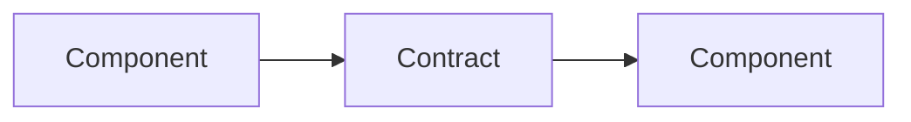

## Context

<Current state, constraints, forces, and what makes this change non-trivial.>

## Goals / Non-Goals

**Goals:**

- <What this design achieves.>

**Non-Goals:**

- <What is explicitly excluded.>

## Decisions

| Decision | Alternatives considered | Rationale | Rejected because |
|---|---|---|---|
| <D1> | <A, B> | <why> | <technical reason> |

## Risks / Trade-offs

- <Risk> → <Mitigation>
- <Worst failure> → <Detection and containment>

## Migration Plan

1. <Deployment order.>
2. <Data or config migration.>
3. <Rollback: exact step, not "revert the PR".>

## Open Questions

<!-- Must be empty before approval. Move answers into Decisions. -->
