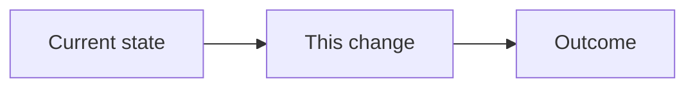

## Review Card (≤ 5 min)

| Field | Value |
|---|---|
| Outcome | <One line a non-author understands.> |
| Why now | <Observed problem or opportunity.> |
| Blast radius | <Services, crates, contracts, chains.> |
| Risk | <Low / Medium / High + worst failure.> |
| Effort | <S / M / L> |
| Decision needed | <None / question> |

### Non-goals

- <Explicitly out of scope.>
- <Another non-goal.>

## Why

<1–2 sentences: the problem, the evidence, and why now.>

## What Changes

- <Specific new capability, modification, or removal.>
- <Mark breaking changes **BREAKING**.>

## Capabilities

### New Capabilities

- `<capability-name>`: <what it covers.>

### Modified Capabilities

- `<existing-capability>`: <which requirement changes.>

## Non-goals

- <Restated explicitly; goals are not non-goals.>

## Impact

- Code: <crates, services, files>
- Contracts: <PolicyEnvelope / IPC / API / DB / CLI>
- Chains/venues: <list or none>
- Tests: <unit / integration / e2e / backtest>
- Ops: <config, metrics, cost>
